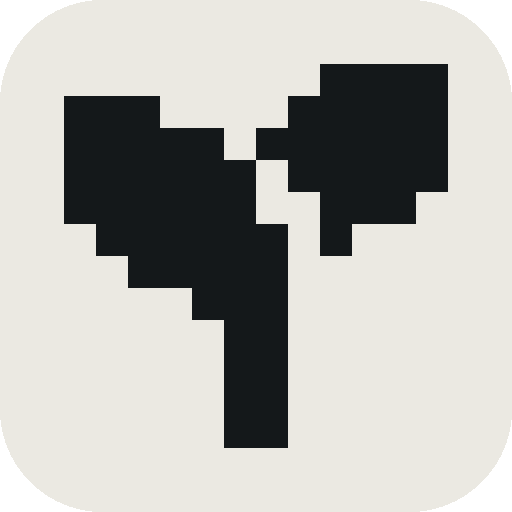

# Ягель

Одностраничный бренд-борд — [`brand-board.pdf`](brand-board.pdf): УТП, визуальная идея,
типографика и палитра на одном листе A4.

## Название

| | |
|---|---|
| Марка | **ЯГЕЛЬ** / **YAGEL** |
| Продукт | **Ягель A1** — настольный монитор воздуха с открытым локальным API и E-Ink-экраном с часами |
| Нейминг линейки | марка + буква класса (A — воздух, S — датчик) + поколение |

Ягель — лишайник-биоиндикатор: растёт только там, где чистый воздух, и первым исчезает
при загрязнении. Где лишайник даёт признак, прибор даёт число.

## Позиционирование

| Элемент | Содержание |
|---|---|
| Конкурентные альтернативы | мониторы Xiaomi, приборы на платформе Tuya, Aranet4; самосборка на ESPHome; проветривание наугад по самочувствию |
| Уникальные свойства | локальный HTTP/JSON API и MQTT по Wi-Fi — без аккаунта и облака; автообнаружение в Home Assistant; настройка Wi-Fi по QR-коду с экрана, без перепрошивки; открытые схема, прошивка и корпус под MIT; E-Ink без подсветки |
| Ценность | два пути к одному прибору: подключить к тому, что уже стоит, ничего не программируя, — или дорабатывать на любую глубину. Данные остаются в локальной сети; цена на уровне массового монитора: плановые 5 000 ₽ |
| Целевой сегмент | те, кто подолгу находится в одной закрытой комнате: работающие удалённо, спящие в закрытых спальнях, сотрудники малых офисов. Внутри — владельцы умного дома на Home Assistant, которым прибор нужен как источник данных для автоматизации: 719 800 активных установок в мире, 11 939 в России (открытая аналитика платформы, 04.11.2026) |
| Категория рынка | настольный монитор микроклимата для умного дома |

Продукт закрывает оба сценария и не заставляет выбирать. Кому нужен готовый прибор —
включает и подключает к Home Assistant без единой строки кода. Кому нужно своё — получает
схему, прошивку, корпус и локальный API и дорабатывает на любую глубину. Ни один из путей
не обходной: это две равноправные двери в один продукт.

Отстройка идёт по условиям доступа к собственным данным. У массовых приборов показания
отдаются через облако производителя, аккаунт или вручную извлечённый токен. Из готовых
приборов в сравнении локальный доступ без аккаунта даёт только Aranet4: по Bluetooth и за
189 USD. Ягель отдаёт показания по своему адресу в локальной сети по Wi-Fi — без аккаунта
и облака.

### Условия доступа к данным

| Кто | Как получают показания | Что мешает |
|---|---|---|
| **Ягель A1** | локальный HTTP/JSON и MQTT по Wi-Fi, автообнаружение в Home Assistant | ничего: без аккаунта и облака. Плановая цена 5 000 ₽ |
| **Приборы на платформе Tuya** | облако и аккаунт (Cloud Push в Home Assistant) | показания в штатной интеграции идут только через облако; бесплатная версия облачного API ограничена квотой и запрещает коммерческое использование. Около 6 200 ₽ |
| **Xiaomi** | локально (Local Polling) | для настройки нужен аккаунт Xiaomi Home или вручную извлечённый 32-символьный токен. 6 800–8 700 ₽ |
| **Aranet4** | локально по Bluetooth (Local Push) | нужно включить функцию Smart Home integration; цена 189 USD |
| **Самосборка на ESPHome** | локально, без облака | компоненты нужно подобрать, собрать и прошить самому |

Цены Xiaomi и Tuya — предложения российских маркетплейсов на 05.11.2026, Aranet4 —
официальный магазин. Условия доступа — документация интеграций Home Assistant и платформы
Tuya.

Aranet показывает, что локальный доступ сам по себе достижим — и что за него просят
соответствующую цену. Ягель занимает свободное место: локальный интерфейс по Wi-Fi без
аккаунта и облака по цене массового монитора.

Характер марки: спокойный, точный, без маркетингового шума. Тон даташита, а не рекламы —
говорим цифрами и схемами. Оценочные эпитеты и восклицательные знаки не используются.

## Слоган

**«Воздух, который видно»** — единственная формулировка, на упаковке, сайте и заставке.

Обещание не заканчивается экраном: те же данные идут в умный дом (MQTT, Home Assistant)
и в веб-интерфейс прибора с историей за 24 часа. Облако, мобильное приложение и
устройства A2 и S1 вынесены в план развития. Экран работает и без сети.

## УТП

> Для **тех, кто подолгу работает и спит в закрытой комнате**, мы создаём **настольный
> монитор воздуха «Ягель A1» с E-Ink-экраном**, который **показывает CO₂, температуру,
> влажность и давление и отдаёт их по открытому локальному API**. В отличие от **Xiaomi
> и приборов на платформе Tuya**, ему не нужны аккаунт и облако; в отличие от
> **Aranet4**, он работает по Wi-Fi и стоит как массовый монитор. Прибор **подключается
> к Home Assistant без единой строки кода, а схема, прошивка и корпус открыты по
> лицензии MIT**.

Короткая формулировка из курсовой работы: открытый локальный доступ к данным
микроклимата по Wi-Fi без аккаунта и без облака по цене массового монитора.

### Открытая платформа

| | |
|---|---|
| HTTP/JSON | показания по адресу прибора в локальной сети, без облака между датчиком и кодом |
| MQTT | публикация в брокер и автообнаружение в Home Assistant; команды и уведомления из Home Assistant выводятся на экран |
| Веб-интерфейс | встроен в прошивку: показания, настройки, история за 24 часа с экспортом CSV |
| Исходники | схема, прошивка и модель корпуса под MIT |

Подключение к Home Assistant не требует программирования: прибор публикует показания в MQTT
и определяется автоматически. HTTP/JSON открывает ту же телеметрию тем, кто строит
своё. Это один поток данных, доступный на двух уровнях подготовки.

Формат данных и протокол описаны в репозитории и не требуют аккаунта и регистрации.
Интеграция работает в локальной сети и не зависит от серверов производителя.

## Логотип

Знак — иконка ростка 16×16: та же графика,
что прошивка рисует на экране рядом со значением CO₂.

- один цвет: чернила `#14181A` или выворотка `#EBE9E2`, без градиентов;
- пиксели не сглаживать и не растягивать: размер кратен 16 px, интерполяция — «ближайший сосед»;
- защитное поле — не меньше 2 пикселей сетки (⅛ стороны знака);
- залитая подложка — только плашка со скруглением ⅕ стороны;
- на фото и текстуры не ставить;
- знак не перерисовывать: правка сетки расходится с прошивкой.

### Файлы

| Файл | Что | Где |
|---|---|---|
| [`assets/yagel-mark.svg`](assets/yagel-mark.svg) | знак, чернила `#14181A` | вёрстка и печать, любой кратный размер |
| [`assets/yagel-mark-inverse.svg`](assets/yagel-mark-inverse.svg) | знак, выворотка `#EBE9E2` | на чернильной подложке |
| `assets/yagel-mark-{16,32,64,256}.png` | растр, чернила, прозрачный фон | экран, документы, фавикон |
| `assets/yagel-mark-inverse-{64,256}.png` | растр, выворотка, прозрачный фон | тёмные подложки |
| [`assets/yagel-mark-512-paper.png`](assets/yagel-mark-512-paper.png) | знак на бумажной плашке со скруглением, 512 px | обложки, слайды, аватар |
| [`assets/yagel-lockup.svg`](assets/yagel-lockup.svg) | основной логоблок: чернильная плашка со знаком вывороткой и слово чернилами на бумаге | шапки, комбинированное обозначение |
| [`assets/yagel-lockup-inverse.svg`](assets/yagel-lockup-inverse.svg) | тот же логоблок вывороткой на чернилах | тёмные подложки, обложки |

### Основной логоблок

Бумажная подложка 151×64 со скруглением 12, поле 12 со всех сторон. Внутри — чернильная
плашка 40×40 со скруглением 8; знак 28×28 вывороткой по центру плашки, поле 6 со всех
сторон. Слово — чернила, Golos Text 800, кегль 20, трекинг `+0.14em`, зазор от плашки 10;
прописные центрируются по высоте плашки. Пропорции сохраняются при любом масштабе.

Надпись хранится кривыми, а не текстом: SVG с `<text>` зависит от наличия Golos Text
у зрителя и на сторонних площадках отрисовался бы чужим шрифтом.

## Цвет

| Роль | HEX | Где |
|---|---|---|
| Чернила | `#14181A` | текст, знак, корпус |
| Бумага | `#EBE9E2` | фон, подложки |
| Ягель | `#3F5F45` | акцент, ссылки |
| Тревога | `#A85F24` | только состояние CO₂ выше порога (по умолчанию 1000 ppm) |

## Шрифты

- **Golos Text** — заголовки и текст (гротеск с полной кириллицей);
- **IBM Plex Mono** — цифры, единицы, подписи, всё что приходит из прошивки.

Не больше двух гарнитур. Прописные подписи — трекинг `+0.16em`, цифры — tabular-nums.

## Товарный знак

Регистрация в Роспатенте, экспертиза — ФИПС; правовая основа — часть 4 Гражданского
кодекса РФ. Заявка подаётся на два обозначения: словесное «ЯГЕЛЬ / YAGEL» и комбинированное
«росток + ЯГЕЛЬ» ([`assets/yagel-lockup.svg`](assets/yagel-lockup.svg)). Классы МКТУ —
09 (приборы) и 42 (разработка и ПО).

До подачи проводится поиск по открытым реестрам ФИПС по заявляемым классам; при занятости
словесной части меняется слово, визуальная система сохраняется. До регистрации используется
знак ™, после — ®. Срок охраны — 10 лет с даты подачи заявки, продлевается. Действующие
размеры пошлин и сроки экспертизы уточняются на сайте ФИПС.
